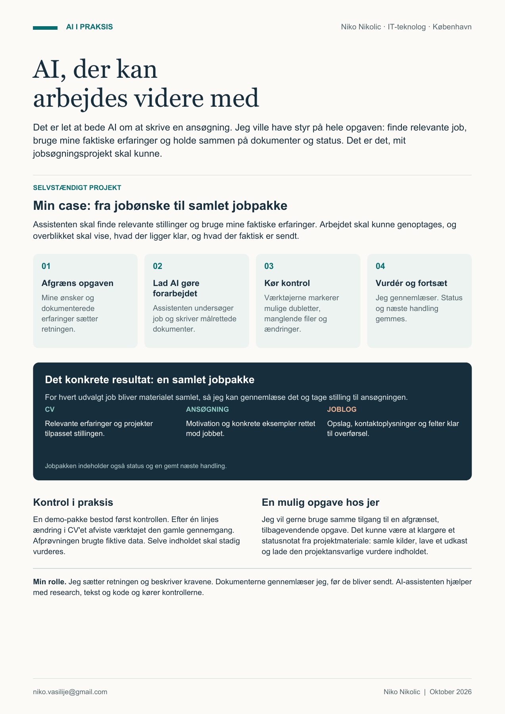

[English](README.md) | **Dansk**

# JobFlow

### AI-assisteret jobsøgning

JobFlow er den arbejdsgang, jeg bruger sammen med en AI-assistent til min jobsøgning. Jeg beskriver mine ønsker og vurderer resultatet. Assistenten finder relevante job, udarbejder dokumenter og kører kontrollerne.

[Se en eksempelpakke](Ansoegninger_Aktive/demo-ai-workflow/AFLEVERING.md) · [Prøv demoen](docs/getting-started.da.md) · [Læs om teknikken](docs/technical-guide.da.md)

[](docs/assets/jobflow-case.da.pdf)

[Hent præsentationen som PDF](docs/assets/jobflow-case.da.pdf) · [Læs samme tekst uden billede](docs/case.da.md)

## Det kommer der ud af arbejdet

| Leverance | Indhold |
| --- | --- |
| Målrettet CV | De erfaringer og projekter, der er relevante for stillingen. |
| Ansøgning, når den kræves | Motivation og konkrete eksempler til jobbet. |
| Joblog | Opslag, virksomhed, adresse og kontaktoplysninger samlet til overførsel. |
| Overblik | Dokumenter, faktisk status og næste handling samlet omkring hver sag. |

Den offentlige **[demo-pakke](Ansoegninger_Aktive/demo-ai-workflow/AFLEVERING.md)** viser en fiktiv stilling, der kun kræver CV. Den indeholder derfor ingen ansøgning. Se også **[Joblog](Ansoegninger_Aktive/demo-ai-workflow/JOBLOG.md)** og **[det samlede overblik](AKTUEL_STATUS.md)** direkte her på GitHub.

## Sådan arbejder vi sammen

| Hvem | Bidrag |
| --- | --- |
| Jeg | Sætter retning, beskriver behov, giver feedback og gennemlæser dokumenterne. |
| AI-assistenten | Undersøger kilder, skriver udkast, hjælper med kode og udfører kontroller. |
| Python-værktøjerne | Holder styr på filer og status og markerer blandt andet ændringer efter en gennemgang. |

Assistenten arbejder i sit eget værktøjsmiljø. Python-værktøjerne laver lokal kontrol og overblik; de søger eller sender ikke ansøgninger på egen hånd.

## Prøv det selv

Hent projektet, og åbn en terminal i mappen. Demoen kræver **Python 3.10 eller nyere**, uden ekstra pakker, API-nøgler eller AI-abonnement.

```text
python demo.py reset
python tools/jobflow.py validate demo-ai-workflow
```

Første kommando gendanner den fiktive jobpakke med aktuelle demodatoer. Den anden kontrollerer, at filer, kildehenvisninger og den syntetiske gennemgang passer sammen. Åbn derefter `AKTUEL_STATUS.md`, gerne i Obsidian.

**[Kom i gang trin for trin](docs/getting-started.da.md)** forklarer download, Obsidian og et lille forsøg, hvor en ændring i CV'et får kontrollen til at reagere.

## Om den offentlige version

Præsentationssiden ovenfor beskriver mit eget projekt og er godkendt til deling. Demoens ansøger, virksomhed, projekter og job er fiktive. Mine private ansøgninger og kvitteringer er ikke med.

Udviklingen og dokumentationen er lavet med AI-assistance. **[Arbejdsgangen](FRAMEWORK.md)** beskriver ansvar og kontroltrin. **[Den tekniske vejledning](docs/technical-guide.da.md)** forklarer test, genoptagelse, grænser og tilpasning i et separat privat arbejdsområde. **[Kontrolnotatet](VALIDATION.md)** viser, hvad der faktisk er afprøvet.
