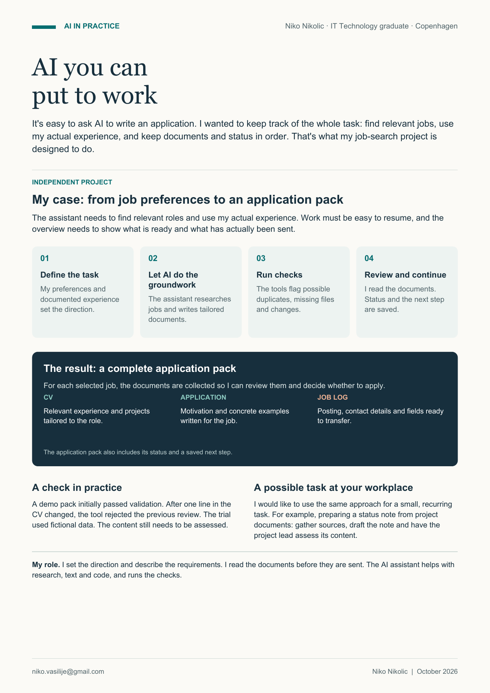

**English** | [Dansk](README.da.md)

# JobFlow

### AI-assisted job search

JobFlow is the workflow I use with an AI assistant to organise my job search. I describe what I am looking for and review the results. The assistant researches roles, prepares documents and runs the checks.

[See an example pack](Ansoegninger_Aktive/demo-ai-workflow/AFLEVERING.md) · [Try the demo](docs/getting-started.md) · [Explore the technical guide](docs/technical-guide.md)

[](docs/assets/jobflow-case.en.pdf)

[Download the introduction as a PDF](docs/assets/jobflow-case.en.pdf) · [Read the same text without images](docs/case.en.md)

## What the work produces

| Deliverable | Contents |
| --- | --- |
| Tailored CV | Experience and projects relevant to the role. |
| Application, when requested | Motivation and concrete examples written for the job. |
| Job log | The posting, employer, address and contact details collected for transfer. |
| Overview | Documents, actual status and the next action brought together for each case. |

The public **[example pack](Ansoegninger_Aktive/demo-ai-workflow/AFLEVERING.md)** uses a fictional vacancy that asks for a CV only, so it contains no application letter. You can also browse its **[job log](Ansoegninger_Aktive/demo-ai-workflow/JOBLOG.md)** and **[overview](AKTUEL_STATUS.md)** directly on GitHub.

## How we work together

| Who | Contribution |
| --- | --- |
| Me | Set the direction, describe needs, give feedback and read the documents. |
| The AI assistant | Research sources, draft documents, help with code and run checks. |
| The Python tools | Track files and status and flag issues such as changes made after a review. |

The assistant works through the tools available in its own environment. The Python tools provide local checks and readable views; they do not search or submit applications on their own.

## Try it

Download the project and open a terminal in its folder. The demo needs **Python 3.10 or newer**, with no extra packages, API keys or AI subscription.

```text
python demo.py reset
python tools/jobflow.py validate demo-ai-workflow
```

The first command restores the fictional application pack with current demo dates. The second checks that its files, source references and synthetic review agree. Then open `AKTUEL_STATUS.md`, optionally in Obsidian.

**[The step-by-step guide](docs/getting-started.md)** covers downloading, Obsidian and a small experiment: change the CV and watch the previous review become invalid.

## About this public version

The presentation above describes my own project and is approved for sharing. The runnable demo uses invented applicant, employer, project and vacancy data. My private applications and receipts are not included.

Development and documentation were AI-assisted. **[The workflow](FRAMEWORK.md)** explains responsibilities and review stages. **[The technical guide](docs/technical-guide.md)** covers tests, resuming work, limits and adaptation in a separate private workspace. **[The validation record](VALIDATION.md)** states what was actually run.
